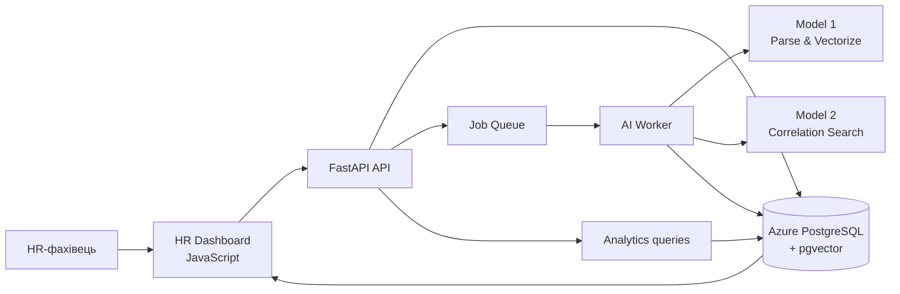
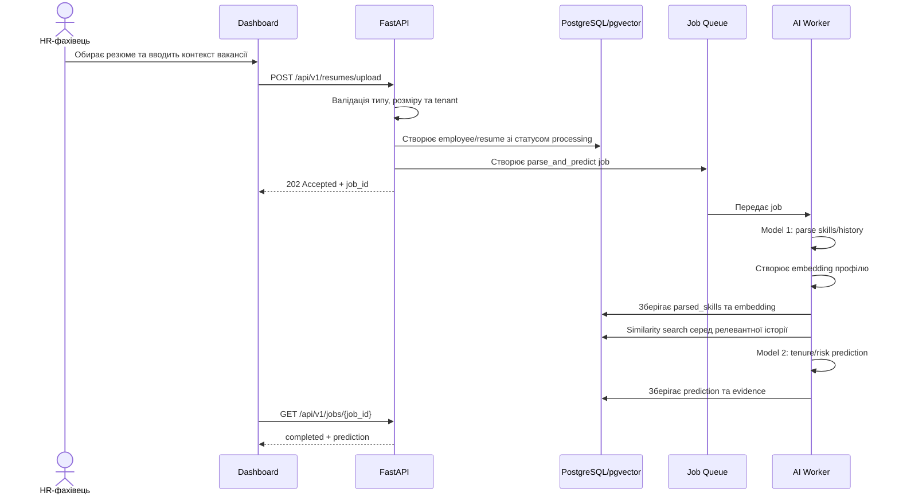
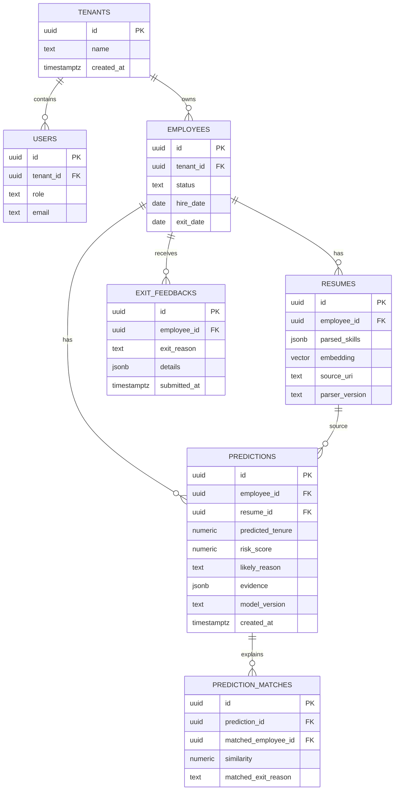
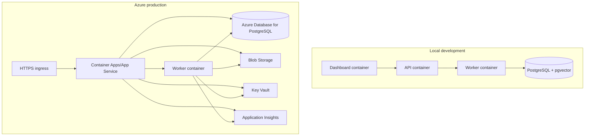

# Hit&Quit: технічна архітектура

## 1. Призначення та межі MVP

Hit&Quit — внутрішня B2B SaaS-платформа для HR. Вона поєднує:

1. структурований профіль кандидата, отриманий з резюме;
2. векторний пошук подібних профілів у внутрішній історії;
3. exit feedback працівників;
4. пояснювану аналітику факторів, пов'язаних із ризиком звільнення.

Система має бути **інструментом підтримки рішення**, а не автоматичним фільтром кандидатів. Прогноз не повинен бути єдиною підставою для відмови в наймі. Для кожного прогнозу потрібно зберігати джерела сигналів, версію моделі та рівень впевненості.

## 2. Архітектурний стиль

Для MVP використовується модульний моноліт:

- один FastAPI-сервіс із чітко розділеними доменними модулями;
- окремий worker для довгих задач парсингу та векторизації;
- одна Azure PostgreSQL база з `pgvector`;
- JavaScript SPA/дашборд;
- Docker Compose для локального запуску та контейнерний деплой в Azure.

Це дозволяє швидко розробляти продукт без розподіленої транзакційності, але залишає межі модулів для подальшого виділення AI worker або analytics service.

## 3. Контекст системи



### Основні компоненти

| Компонент | Відповідальність |
|---|---|
| **Dashboard** | Завантаження резюме, перегляд профілів і прогнозів, внесення exit feedback, перегляд трендів |
| **FastAPI API** | Аутентифікація/авторизація, валідація запитів, CRUD, запуск задач, формування response DTO |
| **Job Queue** | Надійна передача довгих задач worker-у; повтори та статуси задач |
| **AI Worker** | Витягування skills/history, створення embedding, пошук схожих профілів, розрахунок прогнозу |
| **PostgreSQL + pgvector** | Джерело істини для бізнес-даних, audit trail і similarity search |
| **Analytics module** | Агрегації за причинами виходу, tenure, періодами, ролями та підрозділами |
| **Object storage** | Зберігання оригіналів резюме окремо від структурованих ідентифікаційних даних; доступ за короткоживучими URL |

## 4. Потоки даних

### 4.1. Завантаження резюме та прогноз



### 4.2. Exit feedback loop

1. HR відкриває профіль працівника та вносить стандартизовану причину звільнення.
2. API перевіряє доступ до tenant і статус працівника.
3. Feedback зберігається як окрема версія з автором, часом і джерелом.
4. Наступні прогнози можуть використовувати feedback лише після його валідації та потрапляння у дозволений training/evaluation dataset.
5. Перенавчання моделі не виконується синхронно в HTTP-запиті; воно запускається окремим керованим job.

## 5. Логічна модель даних



### Правила зберігання

- Усі бізнес-таблиці мають `tenant_id` або походять через сутність із `tenant_id`.
- `embedding` індексується через `pgvector` після визначення розміру вектора конкретною Model 1.
- Пошук схожості обмежується tenant, роллю/контекстом вакансії та профілями з дозволеним використанням у dataset.
- Оригінальне резюме не повертається з API за замовчуванням; API повертає нормалізований профіль.
- `predictions` є immutable history: новий запуск створює новий запис, а не перезаписує старий.

## 6. API-контракт MVP

| Метод і шлях | Призначення | Відповідь |
|---|---|---|
| `POST /api/v1/resumes/upload` | Прийняти резюме та створити AI job | `202 {job_id, employee_id, status}` |
| `GET /api/v1/employees/{id}` | Отримати профіль і статус | `200 employee DTO` |
| `POST /api/v1/employees/{id}/feedback` | Додати exit feedback | `201 feedback DTO` |

Всі endpoint-и мають повертати узгоджений формат помилки:

```json
{
  "error": {
    "code": "VALIDATION_ERROR",
    "message": "Human-readable explanation",
    "request_id": "uuid"
  }
}
```

API має бути версійованим (`/api/v1`), а довгі операції — асинхронними. Повторне надсилання upload із тим самим idempotency key не повинно створювати дублікати.

## 7. AI pipeline

### Model 1: Parse & Vectorize

Вхід: резюме та контекст вакансії. Вихід:

- нормалізовані hard skills;
- soft skills лише з посиланням на текстове evidence;
- історія ролей і тривалість;
- embedding;
- parser/model version.

Модель не повинна використовувати захищені характеристики або проксі для них. Перед векторизацією потрібна санітизація тексту та маскування зайвих персональних даних.

### Model 2: Correlation Search

1. Виконує tenant-scoped similarity search.
2. Відбирає лише профілі з валідним exit feedback.
3. Розраховує прогноз tenure та risk score.
4. Зберігає top matches, similarity, причини виходу та feature evidence.
5. Повертає `insufficient_data`, якщо вибірка замала, а не вигадує впевнений результат.

У відповіді UI потрібно розділяти:

- спостережувані факти;
- статистичні кореляції;
- прогноз;
- обмеження та рівень впевненості.

## 8. Безпека, приватність і якість

- SSO/OIDC для HR-користувачів; RBAC мінімум: `admin`, `hr_manager`, `analyst`, `viewer`.
- Tenant isolation перевіряється на рівні сервісу та PostgreSQL Row-Level Security.
- Шифрування даних під час передачі й у стані спокою; секрети зберігаються в Azure Key Vault.
- Audit log для перегляду резюме, створення feedback, запуску прогнозу та експорту даних.
- Retention policy для резюме, feedback і audit log; видалення/експорт даних має бути керованою операцією.
- Rate limiting, MIME/розмірна перевірка upload і антивірусна перевірка файлів.
- Моніторинг latency API, failed jobs, черги, model drift, coverage і fairness-метрик.
- Заборонити автоматичні кадрові дії на основі одного risk score; у UI показувати пояснення та ручне підтвердження HR.

## 9. Розгортання



CI/CD має виконувати lint, type checks, unit/integration tests, migration checks і сканування контейнерів до публікації образу. Міграції бази даних запускаються окремим контрольованим кроком перед rollout API.

## 10. Рекомендована структура бекенду

```text
backend/
  app/
    main.py
    api/v1/
      resumes.py
      employees.py
      analytics.py
      jobs.py
    domain/
      employees/
      feedback/
      predictions/
    services/
      resume_parser.py
      embedding_service.py
      prediction_service.py
      analytics_service.py
    workers/
      tasks.py
    db/
      models.py
      repositories/
      migrations/
    schemas/
    core/
  tests/
frontend/
  src/
    pages/
    components/
    api/
    state/
infra/
  docker/
  azure/
```

Модулі взаємодіють через сервіси та DTO, а не напряму через ORM-моделі. Це спрощує тестування і майбутнє виділення worker/analytics у окремі сервіси.

## 11. Етапи реалізації

1. **Foundation:** Docker, FastAPI, конфігурація, міграції, tenant/RBAC, health checks.
2. **Profile ingestion:** upload, object storage, parsing job, `employees`/`resumes`.
3. **Vector search:** embeddings, pgvector index, tenant-scoped similarity queries.
4. **Feedback loop:** exit feedback, audit, dataset eligibility.
5. **Predictions:** Model 2 adapter, evidence, confidence, immutable prediction history.
6. **Dashboard/analytics:** статуси jobs, profile view, prediction explanation, correlations.
7. **Production hardening:** observability, retention, fairness evaluation, backup/restore та disaster recovery drill.
